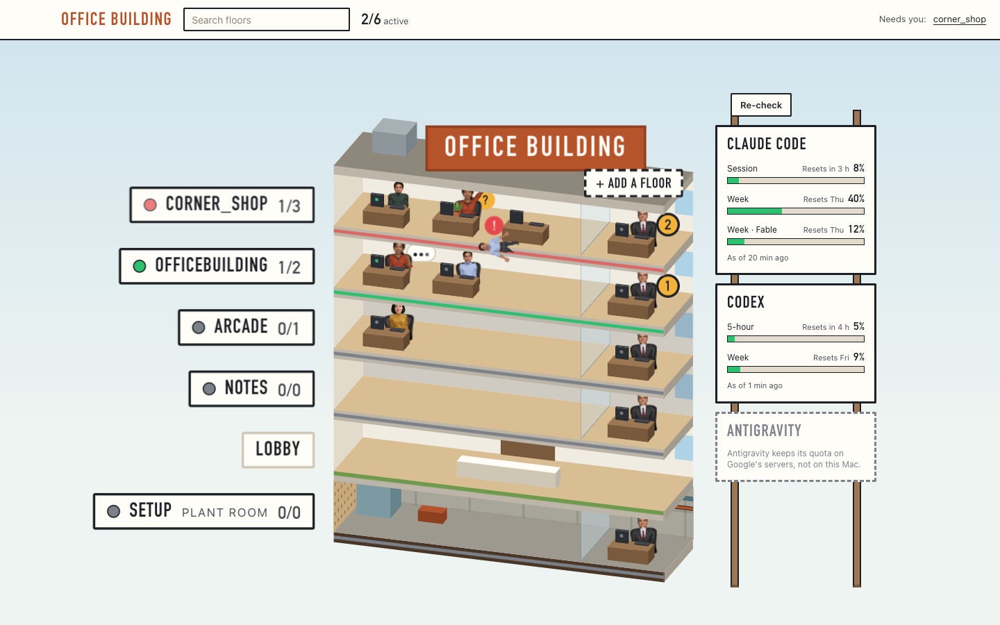
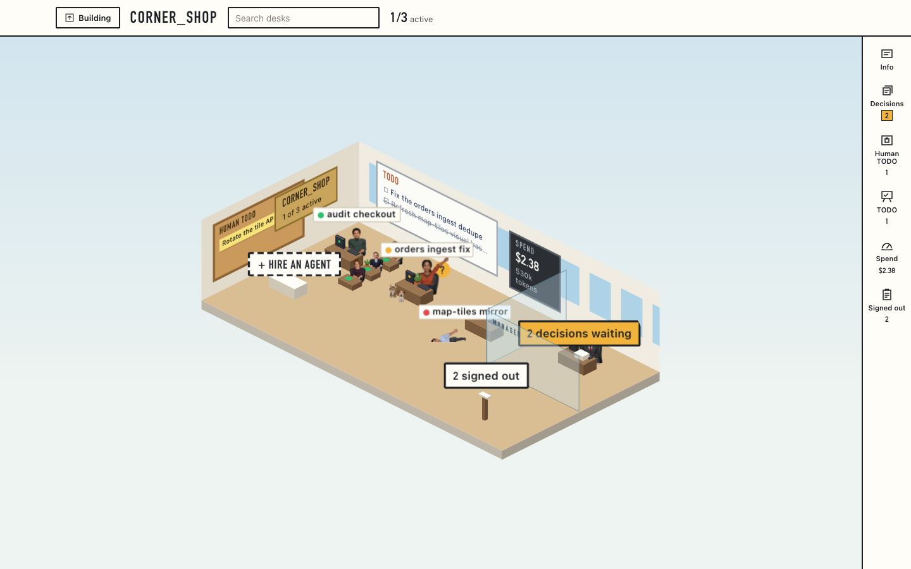
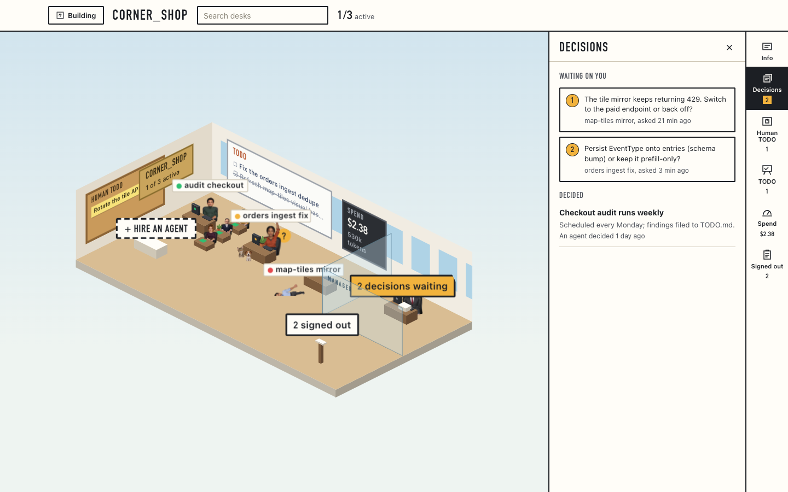
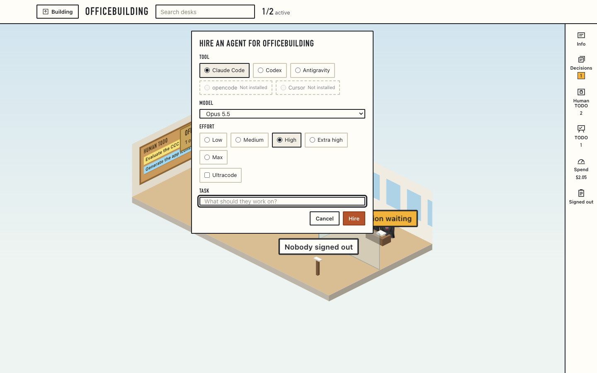
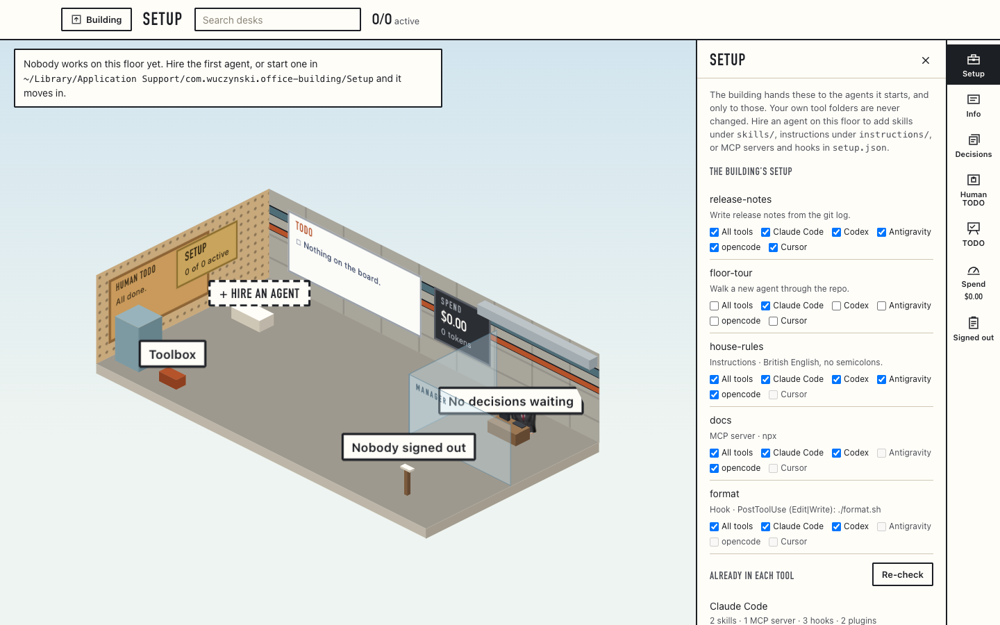

# Office Building

https://github.com/user-attachments/assets/014d3175-0087-4394-9d78-803fc617f775



A macOS desktop app (Tauri v2) that visualises and orchestrates coding-agent
sessions as an **office building**:

- **Floors = projects.** The building is a 2.5D cutaway you can see into. A
  floor's status strip and nameplate lamp (green / yellow / red, off when nobody
  works there) signal whether that project needs attention. Click the sign on
  the roof to rename the building (a blank name restores "Office Building").
  A new floor goes up behind scaffolding. The wrecking-ball button beside a
  floor's nameplate demolishes it: its running agents are stopped cleanly
  (SIGTERM) first, then it collapses into rubble that is quickly cleared, and the
  floors above settle down. It stays down until an agent starts work in that
  folder again or you add it from the roof, and a rebuilt floor keeps its
  sign-out sheet.
- **Desks = agent sessions.** Each desk has a live, animated employee whose pose
  reflects the session state (typing, thinking, hand up for a question, lying on
  the floor when stuck). When a session ends its agent gets up and walks out of
  the door; the floor stays for 12 hours after its last activity. A floor's
  light is green while an agent works, yellow when one needs you, red when one
  is stuck and grey when all are idle. Colleagues walk notes to each other's
  desks (agent-to-agent messages); new hires walk in. A session's running
  subagents, plain or in a workflow, sit at tiny desks beside its own, and one
  that finishes walks a manila folder of its work to its agent on its way out
  of the door. The desks
  shrink as the team grows, and past 64 the rest show as a count. An agent or
  subagent working in a git worktree stays on its repo's floor, with a potted
  plant on its desk. What an agent leaves running stands in front of its desk:
  a background or long-running shell is a seashell, a Claude Code monitor an
  owl, a browser it drives a cat and any other program a dog. The workers and
  pets are realistic cut-outs that move like South Park characters. The room
  fills the window. Scroll (two fingers on a trackpad) to zoom in at the
  pointer, click and drag to pan, and press Fit to see the whole floor again.
- **The manager's panels are objects in the room**, and also sit on a rail at the
  right edge: brass plaque = Info, memo pile on the manager's desk = Decisions
  (questions ordered by priority → one question → A / B / Other), cork board =
  Human TODO, whiteboard = TODO, wall meter = Spend, sign-out sheet by the door =
  Signed out, "Your terminal" over the manager's office = Shells, the manager
  at the desk in that office = Manager. Everything is scoped to the floor you
  are on.
- **Resume an agent that has left.** Sessions that ended in the last 12 hours
  are listed on their floor's sign-out sheet. Resume runs `claude --resume` or
  `codex resume` in an in-app terminal, in the folder the session ran in, on
  the same model and effort. The app never stops a running agent itself, so to
  restart a hung one, exit it first (`/exit`) and resume it from the sheet.
  The three exceptions are the agents on a floor you demolish, a QA
  reviewer the building started itself and a session that is handed over to
  the other tool (below).
- **Decisions and TODOs come from each repo's own files**: open and settled calls
  from `FOUNDER_DECISIONS.md` (or `HUMAN_DECISIONS.md`) plus the agents'
  `DECISIONS.md` log, your actions from `FOUNDER_TODO.md` (or `HUMAN_TODO.md`),
  agent work from `TODO.md`. A call is open until its `##` heading carries a
  status (`DECIDED <date>`, `CONFIRMED`, `VETOED`, `DEFAULT APPLIED`...). Under a
  heading that only groups calls, each `- [ ] **Title** …` item is a call and
  `- [x]` a ruled one, and so is each `### ID · Title · …` entry (settled when the
  group heading says Answered or Decided). Hyphenated names such as
  `FOUNDER-DECISIONS.md` and `FOUNDER-TODO.md` work too. Answering a call or ticking an item in the app writes
  back into the file (a checklist call gets ticked and a `**Ruled <date>:**` line).
  Repos without these files fall back to the app's own records.
- **Connectors: a floor's TODOs can also come from Linear.** Paste one Linear
  key (a personal application programming interface key, or API key) in
  Settings, under Connectors. It is checked with Linear, then kept in the
  macOS Keychain and nowhere else. On a floor's Info panel, the Linear
  row connects the floor to a team, and optionally to one project and one
  label. Issues assigned to you then go on the cork board. Unassigned issues,
  and issues carrying the agent label (`agent` unless you change it in
  Settings), go on the whiteboard. They follow the repo's own items, and
  every item carries a badge saying where it comes from. A `Linear · ENG-123`
  badge opens the issue in your browser. Ticking a Linear item asks first,
  then moves the issue to the team's completed status, and the tick comes
  back off with the reason if Linear refuses. Linear is asked once a minute.
  Each board says when it was last checked and has a Re-check button, and
  when Linear cannot be reached the boards keep their last list and say how
  old it is. Only unstarted and started issues are shown, and the app never
  creates an issue. Connecting a floor pins it.
- **A QA desk reviews your pull requests.** Quality assurance (QA) is off for
  every floor until you switch it on, on the "Quality assurance" row of the
  floor's Info panel. It asks first, because it leads to posts on GitHub, and
  it pins the floor. It needs GitHub's `gh` command installed and signed in
  (`gh auth login`), and a repo whose `origin` is on github.com. The building
  then asks GitHub every few minutes for the open pull requests you wrote in
  that repo. Once a pull request's newest commit has stood for 3 minutes, a
  reviewer sits down at the desk with the magnifying glass in the floor's
  front-left corner. It is an ordinary Claude Code session on your plan, in
  one of the app's terminals, working in a throwaway copy of the pull request
  in the app's data folder. It can read and search files and do nothing else,
  so it cannot edit, run a command, commit or push, and your own checkout is
  not touched. When it reports, the building writes one review from its
  findings and posts it from your own GitHub account under the heading
  "Office Building Quality Assurance". The review is always a comment, never
  an approval or a request for changes. Findings on changed lines become
  inline comments and the rest go in the summary. The building then ends the
  reviewer and removes the copy, and does the same to a reviewer that has run
  for 20 minutes. Each commit is reviewed once, drafts are skipped, and a pull
  request labelled `no-qa` is left alone. A stamp on the desk's tag and on the
  floor's nameplate says "QA passed" or "QA notes". The Info panel lists the
  last reviews, each of which opens on GitHub, and has a Check now button.
- **A manager on each floor hands work to its desks.** A floor has no manager
  until you hire one. The "Hire a manager" sign on the desk in the manager's
  office, and the Manager section on the rail, open the Manager panel, which
  has the button. Hiring pins the floor. The manager is an ordinary Claude Code session on your plan, in one
  of the app's terminals. It can read and search the floor's folder and use
  seven tools the building gives it: list the desks, read a desk, read the
  TODO lists, send a desk a note, wait for a desk, hire a desk and escalate a
  question to you. It cannot run a command, edit a file, stop an agent or
  answer an agent's permission prompt, and it cannot see or touch another
  floor. A note reaches a desk only when that desk is idle. Until then it
  waits, the desk carries a sticky note, and the Manager panel says why. A
  desk without a terminal gets the note as its next turn. A Claude Code or
  Codex desk in one of the app's terminals gets it typed in, starting "Note
  from this floor's manager", but never while it waits on a prompt, never
  within a minute of your last keystroke there and never on top of a line
  you have left unsent. Notes to a desk you started by hand, and to opencode,
  Cursor and Antigravity desks in a terminal, wait and are shown but are not
  typed. A message you send a desk replaces the notes waiting for it. Every
  delivered note is walked across the floor and listed in the panel's log,
  and a desk the manager drives carries a "managed" mark. The manager may
  hire desks only on a floor where you have switched "May hire desks" on, up
  to 3 at once and until the desks it hired have spent 20 US dollars. Paused,
  it can still read the floor, but nothing is sent, hired or escalated. A
  question it escalates lands on the memo pile, and in the repo's
  `HUMAN_DECISIONS.md` when there is one. Its desk light is green while it
  works, yellow while a question of its own is open and off while it is
  paused. To send it home, type `/exit` in its terminal. Its tools reach the
  app through a helper that talks to an owner-only Unix socket in the app's
  data folder, with a random token for each launch held in memory, and
  that socket opens no network port.
- **Hire an agent** from the empty desk: pick the tool (Claude Code, Codex,
  Antigravity, opencode or Cursor; tools not installed are greyed out), the
  model and an effort level the model supports, ultracode for Claude Code, and
  name the task. Model lists come from each tool's own data, so new models
  appear by themselves.
- **The Setup floor** is a plant room in the basement, below the lobby. It holds
  the building's own skills, instructions, MCP servers and hooks, and you pick
  which tools each one goes to (or all of them). The building hands them only to
  the agents it starts, and never changes your own `~/.claude`, `~/.codex` or
  other tool folders:
  - Claude Code gets a generated `--plugin-dir` and `--append-system-prompt-file`.
  - Codex gets an overlay `CODEX_HOME`, which links back to your real one, and
    `-c` options. It asks you to trust the building's hooks once, with `/hooks`.
  - Antigravity gets `--add-dir` (skills and instructions).
  - opencode gets `OPENCODE_CONFIG_DIR` and `OPENCODE_CONFIG_CONTENT`.
  - Cursor gets `--plugin-dir` (skills only).

  The floor's folder (`Setup/` in the app's data folder) is the library itself:
  `skills/`, `instructions/` and `setup.json`. Agents you hire there can edit it.
  Its toolbox opens the Setup panel, which also lists what each tool already has
  (skills, MCP servers, hooks and plugins), updates when those files change, and
  can copy a tool's own skill, MCP server (started by a command or reached over
  HTTP), instructions file or hook into the building, one at a time or everything
  a tool has left at once.
  [`docs/harness-hub-plan.md`](docs/harness-hub-plan.md) has the details.
- **Exact desk states from hooks.** Agents the app starts (Claude Code, and Codex
  once its hooks are trusted) report each hook event to the building, so a
  permission prompt shows as a raised hand straight away.
- **A chat view for desks.** A desk's panel can open as a chat in place of a
  terminal. Settings has an Agents group with View, Terminal or Chat, and
  Terminal is the default. The hire dialog's "Chat view" switch starts at that
  setting and can be changed for one hire. Codex, opencode and Cursor then run
  without a terminal, and the building talks to the agent over its own protocol
  (Codex's app-server, the Agent Client Protocol for opencode and Cursor). A
  Claude Code chat desk is an ordinary Claude Code session in one of the app's
  terminals. Its chat is drawn from the session's transcript and the hook feed,
  so replies appear message by message, and a switch in the panel's head flips
  between Chat and Terminal at any time. Antigravity stays in the terminal for
  now, and its switch is greyed out with the reason. The chat is the same for
  every tool: an agent's messages as Markdown with code blocks, tool calls as
  cards that fold, with the command, the output and file changes drawn as
  diffs, thinking folded away, and approvals to allow or decline where the tool
  has them (with fields to fill in when the agent asks a question or an MCP
  server asks for a form). A Claude Code permission prompt shows as a card
  whose one button flips to the terminal, where you answer it. A message you
  send is typed into a Claude Code terminal, or sent as the next turn, only
  when the desk is idle. Until then it waits above the box with the reason and
  a Withdraw button. "Stop turn" interrupts the turn that is running and never
  ends the agent. Everything in a chat comes from an agent, so raw HTML is not
  drawn, links and images show as text with their addresses and nothing in it
  can be clicked or loaded. A chat opens at 60% of the floor's height and keeps
  the height you drag it to. It shows the recent part of a long conversation,
  and the terminal has the rest. An ended desk without a terminal waits on the
  sign-out sheet, and Resume reopens its conversation on the same desk.
  Markdown is drawn with `react-markdown` and `remark-gfm`.
- **Usage signs** stand beside the building, one per installed tool, with its
  limit windows (5-hour session, week), the time the tool last measured them
  and a Re-check button. Re-check has Claude Code fetch its usage again
  (`claude -p /usage`, with no saved session, hooks or MCP servers); the other
  tools' signs show what they last saved.
- **Click an employee → their terminal.** App-spawned sessions get a full in-app
  terminal docked under the floor (PTY + xterm.js); closing the panel leaves the
  agent running. Drag the panel's top edge (or focus it and use the arrow keys)
  to make it taller, and it keeps that height the next time it opens.
  Discovered / hand-started sessions raise their **original native terminal
  window** instead.
- **Cmd+N on a floor opens a plain shell** in the floor's folder, docked like an
  agent's terminal, for a quick command while you talk to the agents. Each
  Cmd+N is a new shell. They are not agents (no desk, no count) and are listed
  in the Shells panel, which reopens or ends any of them. Closing the panel
  keeps a shell running. End in the panel, or typing `exit`, ends it.
- **Open a desk's code in your editor.** "Open in Cursor" (or VS Code, Zed or
  Devin Desktop, whichever is found first or picked in Settings) sits in the
  header of a desk's panel, on each row of the sign-out sheet and in the Info
  panel, where it opens the floor's folder. Each desk opens the checkout its
  agent is in, so an agent in a git worktree opens its worktree and not the
  floor's main checkout. The arrow beside the button offers the other
  installed editors. Right-click any worker for the same choice, which is the
  way in for hand-started desks, and click a subagent that is working in a
  worktree to open its worktree. Cmd+Shift+O opens the desk whose panel is
  open. The editor's own command is used when your login shell finds it, and
  otherwise the app in `/Applications` or `~/Applications`. If the worktree
  has been removed, the app says so and opens nothing.
- **The building tells you when an agent stops.** It alerts when an agent
  finishes its turn, needs you or is stuck on an error, by a soft system
  sound, a Dock bounce and a system notification. The Dock bounce and the
  notification only happen while another app is in front, and the desk whose
  panel you have open in the app never alerts. Alerts closer together than
  the cooldown (10 seconds unless you change it) arrive as one. Nothing
  alerts on the first scan after launch. Clicking a notification brings the
  app forward.
- **Settings open with Cmd+,** from the building or any floor, and from the
  fuse box beside the toolbox on the Setup floor. Each event and each method
  has its own switch, the cooldown runs from 0 to 600 seconds, and "Test in 3
  seconds" sends a test alert. The Editor group picks the default editor for
  "Open in". The Agents group picks the view new desks open in, Terminal or
  Chat. A change saves at once. Settings are kept in `settings.json` in the
  app's data folder. The Connectors group holds the agent label and the Linear
  key, which has its own Save button and is kept in the Keychain, not in
  `settings.json`. The Quality assurance group sets how often GitHub is asked
  (every 5 minutes unless you change it), whether every push is reviewed or
  only a pull request's first commit, whether drafts are skipped, whether a
  review with nothing to report is still posted, how many reviews run at once,
  how many one pull request gets in a day, and the reviewer's model and effort.
  The Manager group sets a manager's model and effort, which apply to the next
  one you hire, how many desks a manager may hire at once (3 unless you change
  it) and the spend ceiling for the desks it hired (20 US dollars unless you
  change it).
- **Provider routing for Claude Code desks.** A routed desk carries on through
  the next connection you allow when an allowance runs out. It is off until
  you switch it on, and nothing in it has been checked against a real account
  yet. Set it up in Settings, in the Routing group. Name an account context
  (work and personal, say) and give it an ordered list of connections, which
  may be the Claude subscription, an Anthropic API key, OpenRouter or an
  OpenAI API key. The OpenAI route is experimental. It translates each request
  to OpenAI's format and the reply back, it needs "Allow this experimental
  route" switched on as well, and it has never met a real OpenAI account.
  [`docs/provider-routing-matrix.md`](docs/provider-routing-matrix.md) lists
  every pairing and how far each has been checked. Allow
  each billed connection to spend money, type the model names your desks ask
  for under the four tiers, and type each key connection's own model name for
  each tier. Nothing is filled in for you. A key has its own Save button, is
  kept in the Keychain, not in `settings.json`, and is not checked with the
  provider. An Anthropic key has to belong to one workspace. Then pick the
  context on a floor's Info panel and switch "Route Claude Code desks through
  the building" on. From then on a Claude Code desk you hire or resume on that
  floor, in one of the app's own terminals, sends its requests to a router
  inside the app, which listens on `127.0.0.1` only and starts with the first
  routed desk. On the Claude subscription the request and the desk's own login
  go to Anthropic untouched and to no other host. A desk moves to the next
  connection only when a connection reports that its allowance is used up, and
  never to a billed connection you have not allowed or to another account
  context. The desk's panel has a "Route:" strip. Its Details list the desk's
  order, what is used up and when the provider says it resets, with a Retry
  and a "Switch to this" button. When no connection can take a request, the
  agent stops with a sentence that says why. Retry or switch, then tell it to
  carry on. Desks that are already running are not changed when you switch
  routing on or off.
- **What a routed desk loses.** It needs the app. If Office Building quits
  while a routed desk is running, the desk loses its model access, so start it
  again from the sign-out sheet. The router carries the Messages call only, so
  the context meter works from an estimate and any other feature that calls
  Anthropic directly may not work. Claude Code switches Remote Control off on
  a desk with a base address of its own. After a move to OpenRouter, hidden
  reasoning is removed from what the desk sends there, and the visible
  conversation and the tool results are sent in full. On the OpenAI route
  hidden reasoning is left out in both directions, and a request that needs
  documents, tools the provider runs or context management is refused with a
  sentence that says which. The router connects to
  providers directly, so it does not work on a Mac that needs a proxy to reach
  the internet. Your own configuration can take a desk off the router. A shell
  profile that exports `ANTHROPIC_CUSTOM_HEADERS`, an `env`
  block or an `apiKeyHelper` in Claude Code's settings, and the switches for
  Bedrock, Vertex and Foundry all can. Not routed at all are the QA reviewer,
  the manager, chat desks that have no terminal, the other tools and anything
  you started by hand.
- **Handover between the Claude subscription and Codex, in both directions.**
  When a desk that the building started shows its own tool's record that the
  allowance is used up, the building can end that session and start the other
  tool in the same folder, on your own sign-in, with a brief of what was done
  so far. For a Claude Code desk that record is the Claude subscription's
  five-hour or weekly limit. For a Codex desk it is Codex's usage limit on its
  own OpenAI provider. It is off until you set it up in Settings, in the
  Handover group. Each direction needs its own choice of what the receiving
  tool starts with (its own configured default, or a model and effort you
  pick), and nothing is handed over in a direction you have not chosen. Then
  switch "Hand desks over by themselves" on. Nothing is filled in for you. A
  desk with nothing running in the background is then handed over by itself,
  once for each limit. A desk with background work, or where the building
  cannot tell, is never handed over by itself. It gets a "Hand over" button in
  its panel, and using it ends that work. For Claude Code that work is a
  workflow, a helper, a shell or a scheduled wake-up. For Codex it is a goal
  that is neither paused nor complete, or a subagent with a turn still open.
  With the switch off, every used-up desk gets the button. The receiving tool
  arrives as a new desk marked with the tool it came from, and the old session
  goes on the sign-out sheet, where it can be resumed.
- **What a handover sends, and what it never does.** The brief is a file only
  you can read, in the app's data folder and never in your repo. It holds the
  desk's visible conversation with tool output cut short, and a summary of the
  folder's git state. The receiving tool is told to read it, and Claude Code
  is given leave to read that one file and no other. So what was said at the
  desk goes to the other vendor, including any secret a tool printed. Hidden
  reasoning is left out. No login is read, stored or moved. The building only
  asks `codex login status` or `claude auth status` whether the receiving tool
  is signed in, and reads the exit code alone. Only the tool's own record of a
  used-up allowance counts. A throttle, a sign-in failure or a server fault
  hands nothing over. Codex's limit is read from the session's own history
  file. The sentence Codex prints is never parsed, and none of Codex's
  databases, its background server or its goal store is read. The old session
  is asked to stop once and is never forced, and if it does not stop, the
  other tool is not started. A session you started by hand is never handed
  over, a floor's manager cannot hand a desk over, and nothing is handed back
  by itself. A desk that came from Claude Code and then reaches Codex's limit
  stays where it is.
- **What the building cannot see at a Codex desk.** It does not tell a ChatGPT
  plan from workspace credits, a spend cap or an API key's quota. All of them
  read as "Codex's usage limit" and hand the desk over. A limit on one named
  model, a desk on a custom provider and a Codex desk in the chat view hand
  nothing over and show nothing. The building knows when the limit resets only
  if Codex recorded a full window, and holds the record for five hours
  otherwise. A goal you cleared still reads as set, so that desk waits for
  you. Subagents are seen only as a thread with a turn still open. `claude
  auth status` passes for any sign-in method, an API key included. None of the
  handover has run in the installed app or met a real used-up allowance yet.
  What is known about Codex comes from replaying a refusal to Codex 0.161.0 on
  a throwaway home with no login, and nothing was sent to OpenAI.
- **Claude Code and Codex sessions are auto-discovered** from each tool's
  on-disk store, so terminals you started by hand still appear in the building.
  Antigravity, opencode and Cursor agents appear when you hire them from the app.

| A floor | Its Decisions queue |
| --- | --- |
|  |  |
| **Hiring an agent** | **The Setup floor** |
|  |  |

The screenshots show the browser build's mock data.

The visual identity (tokens, type, motion, the 3D rig's constraints) is recorded
in [`DESIGN.md`](DESIGN.md). Full design + research + locked decisions live in
[`docs/office-building-plan.md`](docs/office-building-plan.md).

## Status

- **Frontend:** the full office UI, tested (Vitest, strict TypeScript, runtime
  validation of every backend payload in `src/api/wire.ts`).
- **Backend (Rust, `src-tauri/`):** discovers real **Claude Code** sessions from
  Claude's own files (`~/.claude/sessions/<pid>.json` for liveness and a
  session blocked on you, `~/.claude/projects/**.jsonl` for transcripts), groups
  them into floors by the git root of the folder each session started in (a
  later `cd` does not move it), derives each desk's state, queues open
  questions, permission prompts and plain-prose asks, and pushes live updates to
  the webview. Clicking a running
  desk focuses its exact iTerm2 or Terminal.app tab. Hiring starts the agent
  with the chosen model and effort in an in-app terminal: a pseudo-terminal
  (through your login shell, in the floor's folder) streamed to xterm.js, with
  the last 256 KiB kept for replay. Once the agent registers its session, its
  desk opens that terminal. A Claude Code session that never registers because
  it is stuck on a startup prompt (such as "Do you trust this folder?") gets a
  "New Claude Code session" desk after a few seconds, so its terminal can be
  opened and the prompt answered. Dropping a file (a screenshot, say) onto it types
  the file's path, as iTerm2 does, so Claude Code attaches the image. An agent that stops within 1.5 s of your login
  shell handing over to it (or while the shell's profile is still loading) fails
  the hire with what it printed. One that stops later, before it ever reached
  a desk, is reported in an error message. A hired Codex agent needs a task,
  since Codex only becomes visible once its first turn opens a session file,
  and a Claude Code task cannot be just a `claude` subcommand name such as
  `doctor`. The terminals belong to the app, so quitting the app closes them. **Codex** CLI sessions
  are discovered too, from `~/.codex/sessions/**/rollout-*.jsonl` (titles from
  `session_index.jsonl`). A Codex session counts as running while a `codex`
  process holds its rollout file open, so threads from the ChatGPT desktop app
  only ever show as finished. Codex writes that file only when its first turn
  starts, so until then a running `codex` sits at a "New Codex session" desk.
  Hired and resumed Codex agents skip Codex's update menu.
  Spend is priced at public API list prices (`discovery/pricing.rs`), which is
  what the same work would cost through the API, not what a subscription bills.
- **Not yet:** answering a terminal agent's own question from the Decisions
  panel (answer it in the agent's terminal instead), the app's own MCP
  server for assistant agents, and in provider routing Sign in with ChatGPT,
  which waits for OpenAI's answer on whether the app may use it.
  In the chat view: Antigravity, a read-only chat
  for sessions you started by hand, opening a link, images and attachments, a
  model and effort switcher, plans as cards, sub-agent threads, paging in older
  messages and word-by-word replies from Claude Code. See `TODO.md`. Calls from
  a repo's decision files, and approvals on Codex, opencode and Cursor chat
  desks, are already answered in the app.

The backend is our own. CCC (claude-command-center) moved to a non-commercial,
source-available licence on 2026-07-28, so we port logic only from its last MIT
release, v5.14.0 (see `docs/research/ccc-evaluation.md` and
`THIRD_PARTY_NOTICES.md`).

## Run

Install (pnpm only):

```bash
pnpm install
```

### In a browser (mock data)

```bash
pnpm dev        # Vite dev server on :5183
pnpm test       # Vitest
pnpm build      # production web build → dist/
```

Outside Tauri, `main.tsx` uses `MockApi` with a demo simulation (states change,
colleagues send notes, app-owned desks open a small fake shell), so the whole UI
works without a backend.

### The macOS app (real sessions)

Requires Rust (`rustup`) and Xcode's command line tools.

```bash
pnpm tauri:dev                                # native window on real data
pnpm tauri:build                              # bundle .app / .dmg
cd src-tauri && cargo test                    # Rust unit tests
cd src-tauri && cargo run --example scan      # print what discovery sees
```

To launch it from an icon, run `pnpm app:install`. This builds a release
`.app` and copies it to `~/Applications/Office Building.app`, where Spotlight,
Launchpad and the Dock can find it (to pin it, open the app and choose Options →
Keep in Dock). Run it again after pulling changes. The installed app does not
rebuild itself.

### Sensitive-information hooks

`pnpm install` points git at `.githooks/`. The pre-commit hook refuses a commit
that adds a secret (API keys, tokens, private keys, credential assignments, a
real `/Users/<name>/` path) or a file such as `.env` or `*.pem`. The pre-push
hook checks every commit being pushed, including ones made with `--no-verify`.
Private words, such as names of unpublished projects, go one per line in
`.githooks/sensitive.local.txt`, which is gitignored because committing it would
publish them. For a reviewed false positive, put `sensitive-ok` on the line.
`pnpm check:sensitive` sweeps the whole history.

`pnpm tauri:dev` starts its own Vite server on :5183, so stop `pnpm dev` first.
The Tauri crates are pinned to the 2.11 line to match `@tauri-apps/api`; move
both together. The notification plugin stays on 2.4 until then, because its
later releases need Tauri 2.12. The app icon is generated from `src-tauri/icons/icon-source.svg`
(see `src-tauri/icons/README.md`).

## Layout

```
src/
  types.ts                # data model (mirrored by src-tauri/src/model.rs)
  api/
    DiscoveryApi.ts       # the backend seam: getSnapshot / subscribe / mutations / focusSession / terminals
    tauriApi.ts           # DiscoveryApi over Tauri commands and the snapshot and terminal events
    wire.ts               # zod schemas that validate every backend payload
    mockApi.ts            # in-memory implementation for the browser, plus the demo simulation
    mockData.ts           # seed office (projects, sessions, questions, …)
    HandoverApi.ts        # the handover seam, one call that hands a desk over, with Tauri and mock implementations
    RoutingApi.ts         # the routing seam for a connection's key, a floor's account context and a desk's route, with Tauri and mock implementations
  state/
    selectors.ts          # floor lights, search, per-floor queues/TODOs/spend, labels
    useOffice.ts          # load + subscribe hook with loading / error / retry
    useSettings.ts        # load and save the app's settings
    useEditors.ts         # the editors "Open in" can use, and the default
    useLoad.ts            # load a value when a component mounts, with reading and failed states
  lib/
    iso.ts                # camera + projection maths for the CSS 3D rig
    layout.ts             # where desks, seats and the manager's office stand
    animation.ts          # session state → employee pose, status colours
    looks.ts, time.ts     # stable per-agent looks, true relative times
    routing.ts            # every change the Routing group makes to the routing preferences, as pure functions
    route.ts              # every sentence a routed desk's Route strip shows, as pure functions
    handover.ts           # every sentence a handover shows on the strip, the name tag, the card and the sign-out sheet, as pure functions
  scene/                  # 3D primitives (IsoBox, Wall, Billboard, Stage) + people and pets
    cast/                 # the cut-out rig, its animation and parts.ts (generated by art/cast/cut.py)
  assets/cast/            # the cut-out parts, one folder per character, plus pets
  components/
    building/             # the cutaway: storeys, lobby, roof, directory bar
    floor/                # the room, its objects, rail, sidebar panels, terminal, the chat panel, hire dialog
    settings/             # the Settings plate and its Notifications, Editor, Connectors, Quality assurance, Manager, Agents, Routing and Handover groups
    editor/               # the "Open in" button and its menu
    connectors/           # the Info panel's Linear row and its connect form
    qa/                   # the Info panel's Quality assurance row and the QA stamp
    manager/              # the Manager panel: hire, pause, the plan, waiting notes and the log
    chat/                 # the chat view's parts: Markdown, tool cards, diffs, the approval card and the message box
    routing/              # the Routing group's context and connection cards, the Info panel's Account context row and the Route strip on a routed desk's panel
    handover/             # the Handover strip on a used-up desk's panel, with its button and confirmation row
  styles/                 # tokens (from DESIGN.md) and signage chrome
  App.tsx                 # view-state machine (building ↔ floor) + toasts

src-tauri/
  src/
    model.rs              # serde mirror of types.ts (camelCase / kebab-case)
    discovery/            # Claude Code and Codex sources, state rules, pets, pricing, floor assembly, a Claude Code transcript read as a conversation, a Codex rollout read for its usage limit, its goal and its conversation, the follower both readers share
    office.rs             # discovery + the app's own records behind one lock
    office/               # launching agents in terminals, the Setup floor, structured desks, a desk's folder, TODO lists, a floor's links, fixed-role agents, the QA reviewer's seat, the manager's seat and tools, handing notes to desks, the routed launch, the chat (a desk's view, A Human's own messages, Stop, following a Claude Code conversation), and handing a used-up desk over (reading the proof from either tool's own record, ending the old session, starting the receiver)
    project_files.rs      # decisions and TODOs read from (and written back to) each repo's files
    store.rs              # decisions, TODOs, agent notes (JSON in the app data dir)
    settings.rs, settings/ # the app's settings (settings.json in the app data dir)
    alerts.rs, alerts/    # alerts when an agent stops: state tracker, text, native delivery
    editor.rs             # the editors "Open in" knows: which are installed, how each is opened
    process.rs            # running other programs from an argument vector, with a fake for tests
    connectors/           # outside tools a floor's TODOs come from: the Connector trait, Linear, the hub that caches each floor's list
    qa/                   # the QA desk: the pull request watch, the gh and git calls, the reviewer's brief, its findings, the review that is posted
    manager/              # a floor's manager: its socket, tokens, the MCP server it talks to, the helper mode and the tool list
    delivery/             # notes and messages for desks: cleaning the text, deciding whether a desk can take one, the queue
    routing/              # provider routing, with its preferences, the selection policy, exhaustion records and their file, the failover state machine, connection keys, the router on the loopback address, the relays to Anthropic and OpenRouter, the experimental translation to OpenAI's Responses format, a reply read as evidence, the router's own answers and what a routed launch adds
    handover/             # handing a used-up desk to the other tool: the used-up record and its file, the decision, the work log, the brief and its git summary, the receiver's sign-in check, first prompt and leave to read the brief, and the view
    secrets.rs            # secrets that cannot be printed, kept in the macOS Keychain, with a fake for tests
    http.rs               # one HTTPS JSON POST on the system's TLS, with a fake for tests
    poll.rs               # a background job on a timer that backs off, waits when told to and can be woken
    options.rs, options/  # hireable tools, models and per-model efforts, tools' own model lists
    setup/                # the Setup floor's library, each tool's inventory, import, injection
    structured/           # the conversation model every chat uses, and desks without a terminal: Codex app-server and ACP clients
    feed.rs, feed/        # the hook status feed from agents the app launches, and what its events say about background work
    tools.rs              # which agent CLIs are installed
    usage.rs              # each tool's usage-limit windows
    focus.rs              # focus a session's terminal tab, the folder picker
    pty.rs                # in-app terminals for hired agents: PTY, output events, scrollback
    watch.rs              # file watch + tick → office://snapshot
    commands.rs           # #[tauri::command] fns backing DiscoveryApi
    lib.rs / main.rs      # Tauri wiring, and the manager's helper mode, which starts no window
  examples/scan.rs        # print what discovery sees on this Mac
  capabilities/default.json
  tauri.conf.json

art/cast/
  raw/                    # Codex's parts sheets (image generation), one per character plus pets
  cut.py                  # cuts the sheets into src/assets/cast: uv run --script art/cast/cut.py
```

## Open work

Tracked in [`TODO.md`](TODO.md).

## Licence

MIT, see [`LICENSE`](LICENSE). Parts of the session-state rules and terminal
focusing are ported from Claude Command Center v5.14.0 (MIT), see
[`THIRD_PARTY_NOTICES.md`](THIRD_PARTY_NOTICES.md).
